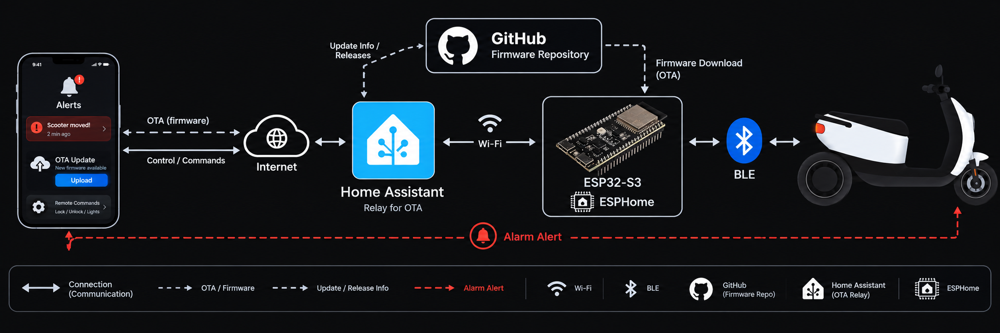

# Librescoot-BLE-Component — Home Assistant integration

Home Assistant companion for the
[Librescoot-BLE-Client ESPHome component](https://github.com/dtill/librescoot-esphome#mdb-nrf-ble-client):
an ESP32 next to your scooter that talks to it over Bluetooth, so lock/unlock, blinkers,
seatbox, batteries, status, alarm and firmware updates show up in Home Assistant.

It is made for **offline scooters** — scooters without an LTE contract — but works for every
Librescoot scooter. The big plus over the phone app: **sensor readings and the alarm keep working
while the scooter hibernates**, and you get a **Bluetooth presence sensor** that tells you whether
the scooter is at home.

## What you need

- an **unu Scooter Pro** running **Librescoot 1.4.0 or newer** with **nRF firmware v2.12 or newer**
- an **ESP32** (classic) or **ESP32-S3** board flashed with the
  [Librescoot-BLE-Client ESPHome component](https://github.com/dtill/librescoot-esphome#mdb-nrf-ble-client)
  and added to Home Assistant through the ESPHome integration — on a classic, firmware updates
  need this integration; an ESP32-S3 can also download them from GitHub itself
- Home Assistant with HACS

## What this integration adds

The ESP does the everyday work on its own. This integration handles the moments where Home
Assistant can help:

- **Pairing made easy** — when the scooter is nearby but not paired, a Repair walks you through it:
  press *Start pairing*, type the code from the scooter's dashboard, done.
- **Firmware updates** — Home Assistant fetches the release and hands it to the ESP over your home
  network; the scooter's updates appear like any other update in Home Assistant. Each update uses
  the smallest file that fits — the HDiffPatch `.hdelta` where the scooter supports it, else the
  regular `.delta`. Before a delta update starts, it checks that the update fits the version the
  scooter runs, so a mismatching one is refused before any transfer.
- **Faster updates for scooters that are several releases behind** — several update steps are
  combined into one install and one reboot. Newer scooters (nightly `20261109T030336` or later)
  do this themselves: the ESP uploads each step and the scooter installs them together — no Home
  Assistant needed. For older scooters Home Assistant merges the steps into one file; this works
  on Home Assistant on x86_64 and on 64-bit ARM (Raspberry Pi 4/5, or a Raspberry Pi 3 with the
  64-bit Home Assistant OS). If it cannot run on your host, the steps are installed one after
  another.
- **Stuck after an update?** — if the scooter does not reboot on its own, a Repair offers to restart it.
- **Find a new scooter** — a scan in the integration's options lists nearby scooters with their
  Bluetooth address for the ESPHome configuration.
- **The scooter alarm as a Home Assistant alarm panel** — arm and disarm from the alarm card, a
  voice assistant or the Home app (through the HomeKit bridge), with an optional code.
- **Status you can see and automate** — whether the ESP is online, whether Home Assistant found it,
  and what the firmware relay is doing, as entities with history.

## How it is organised

The integration has two kinds of entries:

- **Librescoot Relay** — one per Home Assistant, created automatically. It serves firmware, release
  lists and update checks to the ESPs and holds the settings they share: the address the ESPs use
  to reach Home Assistant, the port, and an optional GitHub token. If you delete it, a Repair
  offers to add it again.
- **One entry per ESP** — found automatically once the ESP is in the ESPHome integration. Its
  options hold the update channel, the alarm code and the scooter picker.

Each entry has its own device with the entities below. The ESP's own entities stay on its ESPHome
device.

### ESP entry

| Entity | Type | Description |
| :--- | :--- | :--- |
| Alarm | alarm control panel | The scooter alarm: disarmed, arming, armed away, pending (warning stage), triggered. Arming switches the alarm on first if it is off. Attributes: scooter status, last trigger and its time. |
| ESP Online | binary sensor (connectivity) | The ESP answers a ping on your network. Attributes: address, round-trip time. |
| ESP Linked | binary sensor (problem) | Problem when Home Assistant cannot find the ESP's ESPHome device — then pairing prompts and updates through Home Assistant do not work. |
| BLE Link Mode | sensor | The ESP's Bluetooth link mode (change it on the ESP's own select). |
| Relay URL | sensor | The address Home Assistant gives the ESP for firmware. Attributes: the address the ESP actually uses, its byte source. |
| Relay URL Mismatch | binary sensor (problem) | Problem when the ESP uses a different address than Home Assistant gives it. |
| Relay Last Request | timestamp | When the ESP last reached the relay. Attributes: what it asked for, the answer code. |
| Relay Bytes Served | data size | Firmware bytes sent to this ESP since Home Assistant started. |
| Relay Transfer Speed | data rate | Current firmware transfer speed to this ESP. |
| Chain Build | sensor | Progress when Home Assistant combines several update steps into one file. |

### Librescoot Relay entry

| Entity | Type | Description |
| :--- | :--- | :--- |
| Listener | binary sensor (problem) | Problem when the relay is not running (for example its port is taken). Attribute: the last request with an unknown address — a sign of an ESP with an old address. |
| GitHub API Remaining | sensor | GitHub requests left this hour (60 without a token, 5000 with one). |
| Registered ESPs | sensor | How many ESPs the relay serves. |
| Bytes Served Total | data size | Firmware bytes sent to all ESPs since Home Assistant started. |
| Chain Cache Size | data size | Disk space used by combined update files. |
| xdelta3 | sensor | Whether combining update steps works on this host. |

## Install

1. Click the button above, or add **https://github.com/dtill/librescoot-homeassistant** in HACS as a
   custom repository of type *Integration*.
2. Install **Librescoot-BLE-Component** and restart Home Assistant.
3. Your ESP is discovered automatically once it is added through the ESPHome integration — confirm
   the notification, or go to *Settings → Devices & Services → Add Integration →
   Librescoot-BLE-Client* and enter the ESP's node name.

**No ESP configuration yet?** *Add Integration → Librescoot-BLE-Client → Set up a new ESP* asks for
the board, the scooter (Home Assistant lists the scooters it hears over Bluetooth), a name and your
WiFi, then creates the ESPHome configuration from the current example in your ESPHome folder and
adds the secrets it needs to `secrets.yaml` (existing entries are never changed). Install it from
the ESPHome Device Builder (*Install → Plug into this computer*) and enter the encryption key the
wizard shows when Home Assistant reports the new device. You can go back at every step, and an
unfinished setup can be continued later. Requires the ESPHome Device Builder add-on.

Manual install: copy `custom_components/librescoot_ble_client/` into your Home Assistant
`config/custom_components/` folder, restart, then add the integration as in step 3.

## Where to find things

| What | Where in Home Assistant |
| :--- | :--- |
| Pairing, "scooter stuck", "ESP not found", "different relay address" prompts | *Settings → System → Repairs* |
| Relay address and port, GitHub token | *Settings → Devices & Services → Librescoot-BLE-Client → Librescoot Relay → Configure* |
| Update channel, alarm code, find a scooter | *… → Librescoot-BLE-Client → your ESP's entry → Configure* |
| Online, link mode, relay status, alarm panel | the **… (HA)** device of your ESP's entry |
| Firmware updates | the scooter's **OTA MDB Update** / **OTA DBC Update** entities |
| Everything the ESP can do | the ESP's ESPHome device page |

A GitHub token is optional; it only raises GitHub's request limit if you check for updates very
often. Create a fine-grained token on GitHub with read-only access to public repositories.

## Need more?

The full list of entities, how pairing and updates work in detail, and troubleshooting are in the
[ESPHome component's README](https://github.com/dtill/librescoot-esphome/blob/main/components/librescoot_ble_client/README.md).
